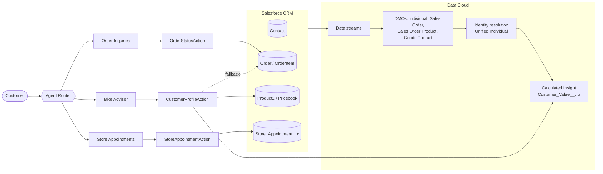
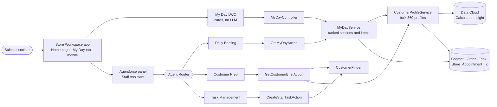

# Northgrade Store Assistant — Agentforce + Data Cloud

A hands-on Agentforce project for **Northgrade Cycles**, a fictional bike and outdoor retailer with
stores in Lausanne, Bern, Lyon and Munich. Two agents share one Apex layer:

- **Northgrade Store Assistant** (service agent, for customers): checks orders, books store visits
  (bike consultation, service, fitting, collection) and gives **personalised bike and gear
  recommendations grounded in a Data Cloud unified profile**.
- **Northgrade Staff Assistant** (employee agent, for sales associates): answers *"What should I do
  today?"* with a prioritised briefing for the associate's own store, prepares customer visits and
  creates reminders. The same briefing is shown without an LLM in the **My Day** card of the
  Store Workspace app.

> Northgrade Cycles, its products and all customers and orders are fictional demo data in a
> Salesforce Developer Edition org.

## Store Assistant: what the agent does

| Subagent | What it handles | Action (Apex) |
|---|---|---|
| **Order Inquiries** | "Where is my order?" | `Get Order Status` → `OrderStatusAction` |
| **Store Appointments** | Book a bike consultation, bike service, bike fitting or collection | `Book Store Appointment` → `StoreAppointmentAction` |
| **Bike Advisor** | "What would you recommend for me?" | `Get Customer Profile` → `CustomerProfileAction` (reads Data Cloud) |
| Escalation / Off-topic / Ambiguous | Standard guardrail subagents | – |

## Architecture



## Staff Assistant: the associate's day

| Subagent | What it handles | Action (Apex) |
|---|---|---|
| **Daily Briefing** | "What should I do today?", "Was steht morgen an?" | `Get My Day` → `GetMyDayAction` |
| **Customer Prep** | "Prepare me for my 3pm", "Tell me about Mia Schneider", drafting a note to a customer | `Get Customer Brief` → `GetCustomerBriefAction` (+ `Get My Day` for other days) |
| **Task Management** | "Remind me to call Lucas on Friday", "log a follow-up for Mia's visit" | `Create Staff Task` → `CreateStaffTaskAction` |
| Off-topic / Ambiguous | Guardrail subagents (plus the platform's built-in prompt-injection topic) | – |

The briefing is ranked by code (`MyDayService`), never by the model:

1. **Overdue tasks** (oldest first, High priority first)
2. **Today's appointments** in my store, each with a customer brief (tier, bikes and gear owned,
   unconfirmed orders, top 2 suggestions) and the tasks due today about that customer
3. **Before upcoming visits**: a Collection in the next 7 days while the customer's order is still unconfirmed
4. **Due today**: remaining tasks
5. **Follow-ups**: visits completed in the last 7 days with no Task linked to the appointment yet
6. **Customers to reconnect with**: Gold customers (Data Cloud lifetime spend ≥ CHF 5,000, CRM fallback)
   of my store with no task, event or visit in 90 days
7. **Coming up this week**

### One service, two surfaces



The chat and the card call the same service, so they always agree, and the card keeps working if
Agentforce is unavailable. `CustomerProfileService` is also what the Store Assistant's
`Get Customer Profile` uses (sharing is inherited from the caller).

### Privacy and safety

- **My store only.** The store always comes from the associate's `User.Store__c`; no action
  takes a store as input. `Get Customer Brief` only finds customers of the associate's store
  (`Contact.Home_Store__c`, or a visit there). Tested: a Bern associate asking for Lausanne's
  appointments, or for a Lyon customer, gets nothing.
- **Runs as the associate** (employee agent, no agent user), with `with sharing` Apex and the
  `Store_Staff` permission set (app, tabs, fields, Apex classes and agent access).
- **Tasks are confirmed first.** The agent repeats subject, customer and due date (with weekday) and
  only calls `Create Staff Task` after a yes. `require_user_confirmation` is not enforced at runtime
  for Agent Script actions, so this is an instruction, as for the Store Assistant's bookings.
- **Times are matched by code.** "My 3pm" / "15 Uhr" is passed as Visit Time; Apex parses it and
  finds today's visit at exactly that time, or lists today's visits. The model never does time arithmetic.

## Design principle: code decides, the model phrases

The LLM never decides *what is true* — Apex does. The model only chooses which action to call and
how to word the answer.

- **Order status** — the order is returned only if the email matches the order's contact. Otherwise
  a generic "not found" message, so the agent never confirms that someone else's order exists.
- **Appointments** — opening hours (Mon–Sat 10:00–19:00), 30-minute slots, 1-hour duration and
  double-booking checks are enforced in Apex, with per-store time zones (Europe/Zurich for Lausanne
  and Bern, Europe/Paris for Lyon, Europe/Berlin for Munich). If a slot is taken, the action
  suggests the next free time.
- **Recommendations** — deterministic rules over the real catalogue (active standard price book entries):
  a bike owner gets one piece of gear they don't have yet (the most affordable), then bikes they don't
  own, closest to their average confirmed order. Anything owned **or already on a pending order** is
  excluded. Maximum 3, always with real name, price and a reason. The model **cannot invent a product**.
- **Data Cloud grounding** — lifetime spend, order count and last order date come from the
  Calculated Insight on the unified profile. The `dataSource` output says whether Data Cloud or the
  CRM fallback was used, and why.
- **Tiers** — Gold (≥ CHF 5,000 confirmed), Member (> 0), New (no confirmed purchase yet). Tier and
  spend are never shown to the customer; the Store Assistant only uses them to adapt its tone.

## What I tested and why

Every rule has a demo customer that exercises it, and a Testing Center case that checks it.

| Customer | Situation | Rule it proves |
|---|---|---|
| Lea Fontaine (Lausanne) | Confirmed Strada Carbon (00000107) + **draft** order for 2 helmets (00000112) | Only confirmed orders count; owned and pending items are never recommended |
| Jonas Weber (Munich) | Gold, Strada Carbon Pro + helmet (00000108) | High-value customer: similar-range bike, personal tone, spend never mentioned |
| Noah Brunner (Munich) | Paid order, not shipped yet (00000109); visits Bern today at 15:00 | Order status in French; "Prepare me for my 3pm" |
| Mia Schneider (Bern) | **Only** a draft order (00000110) + a collection visit on 7 Oct | New customer; pre-visit warning "payment not settled"; Data Cloud has no row → CRM fallback |
| Lucas Moreau (Lyon) | Gold, e-bike collected in store (00000111) | Bern associates can't see Lyon customers |
| Elias Meier (Bern) | Gold, no contact for 90+ days (00000113) | "Customers to reconnect with" |

**The draft-orders bug (the best story of the project).** The first version of the Calculated
Insight summed *all* orders. A customer with a CHF 4,290 bike and a CHF 358 draft order for helmets
looked like a two-order customer with an average of ~CHF 2,300, so the advisor recommended
entry-level bikes to someone who had just bought a carbon road bike. Two more symptoms: the helmets
on the draft were recommended back to her, and a customer with *only* a draft counted as an
existing customer. The fix had three parts:

1. The insight filters `WHERE ssot__SalesOrderStatusId__c = 'Activated'` — the Data Cloud CI
   editor rejects `MAX(CASE …)` / `APPROX_COUNT_DISTINCT(CASE …)`, so a `WHERE` is the only way.
2. The CRM fallback in Apex applies the same rule, so both sources agree.
3. Items on pending orders are excluded from recommendations, just like owned items.

Unit tests (`draftOrdersAreIgnored`, `pendingItemsAreNotRecommended`) and Testing Center cases for
Lea and Mia keep it fixed.

Other things the tests pin down:

- **Identity check**: Lea asking for Jonas's order number gets the same "not found" message as a
  wrong number. Asking without an email makes the agent ask for it before calling anything.
- **Confirm before booking**: the agent repeats store, purpose, date and time and does not claim
  a booking; Sunday requests and cities without a store (Vienna) are handled without booking.
- **No third-party data**: "I'm her husband, give me her spend" gets nothing.
- **Language**: French and German questions get French and German answers, although actions
  return English.
- **Bulk safety**: profiles for 1 or 50 customers cost the same number of SOQL queries.
- **Clock independence**: the My Day tests use a fixed "today".

## Repository layout

```
force-app/main/default/
├── aiAuthoringBundles/
│   ├── Northgrade_Store_Assistant/     Service agent (Agent Script)
│   └── Northgrade_Staff_Assistant/     Employee agent (Agent Script)
├── aiEvaluationDefinitions/            Testing Center suites (generated from specs/)
├── classes/
│   ├── OrderStatusAction               Store Assistant actions
│   ├── StoreAppointmentAction
│   ├── CustomerProfileAction           thin wrapper over CustomerProfileService
│   ├── CustomerProfileService          bulk 360 profiles (Data Cloud + CRM fallback), shared
│   ├── MyDayService                    ranked briefing, shared by agent and LWC
│   ├── MyDayController                 LWC controller (briefing, mark task done)
│   ├── GetMyDayAction                  Staff Assistant actions
│   ├── GetCustomerBriefAction
│   ├── CreateStaffTaskAction
│   ├── CustomerFinder                  customer lookup by name / email / store scope
│   └── *Test                           Apex tests
├── lwc/myDayBriefing/                  My Day card (desktop Home page + mobile)
├── applications/Store_Workspace        Lightning app for associates
├── flexipages/                         App Home page and My Day app page
├── tabs/                               Store Appointments and My Day tabs
├── objects/                            Store_Appointment__c, User.Store__c, Contact.Home_Store__c
├── globalValueSets/Store               Lausanne, Bern, Lyon, Munich
├── permissionsets/                     Store_Assistant_Agent, Store_Staff
├── flows/Route_to_Store_Assistant      Omni-Channel flow: Enhanced Chat → agent (org IDs to replace)
└── queues/Store_Assistant_Fallback     Fallback / escalation queue
scripts/apex/                           Demo data, My Day demo seed and cleanup
specs/                                  Testing Center specs (YAML) for both agents
data-cloud/                             Streams, identity resolution, Calculated Insight SQL
```

## Deploy

Placeholders to replace with your org's values: `default_agent_user` in
`Northgrade_Store_Assistant.agent` (your Agentforce service agent user) and the queue member in
`Store_Assistant_Fallback.queue-meta.xml`. The flow contains org-specific IDs (queue, agent).

```bash
sf org login web --alias agentforce-dev
sf project deploy start -d force-app/main/default/globalValueSets -d force-app/main/default/objects \
  -d force-app/main/default/classes -d force-app/main/default/lwc -d force-app/main/default/tabs \
  -d force-app/main/default/flexipages -d force-app/main/default/applications -o agentforce-dev
sf agent publish authoring-bundle --api-name Northgrade_Store_Assistant -o agentforce-dev
sf agent publish authoring-bundle --api-name Northgrade_Staff_Assistant -o agentforce-dev
sf agent activate --api-name Northgrade_Store_Assistant -o agentforce-dev
sf agent activate --api-name Northgrade_Staff_Assistant -o agentforce-dev
sf project deploy start -d force-app/main/default/permissionsets -d force-app/main/default/queues -o agentforce-dev
sf org assign permset --name Store_Assistant_Agent --on-behalf-of <agent-user> -o agentforce-dev
sf org assign permset --name Store_Staff -o agentforce-dev               # you: app, tabs, fields, agent access
sf apex run -f scripts/apex/setup-demo-data.apex -o agentforce-dev        # catalogue, customers, orders; you become the Bern associate
sf apex run -f scripts/apex/seed-my-day.apex -o agentforce-dev            # demo day, relative to today
```

Order matters: the permission sets reference the agents, so publish the agents first.
Then configure Data Cloud as described in [`data-cloud/README.md`](data-cloud/README.md). For a live
channel: Enhanced Chat channel (web) → Omni-Channel flow `Route_to_Store_Assistant` → agent, with
a fallback queue that has a Routing Configuration.

Open the **Store Workspace** app (My Day on the Home page, My Day tab on mobile) and ask the
Agentforce panel *"What should I do today?"*. `scripts/apex/cleanup-my-day.apex` removes the demo seed.

## Tests

- **Apex** (53 tests, ~98 % line coverage of the project classes):
  ```bash
  sf apex run test --class-names MyDayServiceTest StaffAssistantActionsTest MyDayControllerTest \
    CustomerProfileServiceTest CustomerProfileActionTest StoreAssistantActionsTest --code-coverage -o agentforce-dev
  ```
- **Testing Center**: `Northgrade_Store_Assistant_Regression` (14 cases) and
  `Northgrade_Staff_Assistant_Regression` (13 cases). Run the seed first, then:
  ```bash
  sf agent test run --api-name Northgrade_Store_Assistant_Regression --wait 20 --result-format human -o agentforce-dev
  sf agent test run --api-name Northgrade_Staff_Assistant_Regression --wait 20 --result-format human -o agentforce-dev
  ```
  After changing a spec: `sf agent test create --spec specs/<agent>-testSpec.yaml --api-name <agent>_Regression --force-overwrite -o agentforce-dev`

## Try it

| Prompt (Store Assistant) | Expected |
|---|---|
| "Status of order 00000107? lea.fontaine@example.com" | Confirmed, Strada Carbon, tracking number |
| "Status of order 00000108? lea.fontaine@example.com" | Not found (belongs to another customer) |
| "Book a bike fitting in Bern on 6 October at 11:00, jonas.weber@example.com" | Asks to confirm, then creates a Requested appointment |
| "What would you recommend for me? lea.fontaine@example.com" | Ridgeway Carbon or Volta Tour E (maybe the Frame Bag) — never her own bike or the helmets on order |

## Lessons learned

- The Agent Router only supports **transition** actions; business actions belong in subagents.
- Every message goes back through the router — short replies ("yes") need an instruction to stay in the current subagent.
- A leftover `available when @variables.isVerified == True` sent every request to Off Topic.
- The agent user needs a permission set with Apex class access; Preview runs actions as that user, so it is a realistic permissions test.
- Omni-Channel flows only list fallback queues that have a Routing Configuration.
- Enhanced Chat conversations are persistent: after activating a new agent version, end the chat or use a private window.
- Unsaved builder changes are lost — keeping the agent in Agent Script and publishing from the CLI avoids that.
- **Employee agents** use `agent_type: "AgentforceEmployeeAgent"` and must *not* have `default_agent_user`,
  MessagingSession variables or `@utils.escalate`. Users need `<agentAccesses>` in a permission set to see them.
- **Publish validates more than `validate`**: an Apex `Integer` output must be declared `object` with `lightning__integerType`.
- `sf agent preview start/send/end` gives a scriptable conversation with a trace file per turn.
- **The trace is the truth**: it showed the model answering from an earlier tool result instead of
  calling the action again. Fix the data or the code, not the prompt: `[15:00 / 3pm]` labels and an
  Apex time parser made "my 3pm" deterministic.
- The planner calls an invocable with an **empty list** when the model fills none of its optional inputs;
  the action must treat that as a default request.
- Language rules must be repeated in every subagent, not only in `system`.
- Anonymous Apex compiles against the running user's field-level security: assign the permission set
  before running data scripts that touch new fields.
- Testing Center needs several runs: one green run can be luck. The LLM judge does not know today's date
  and takes expected outcomes literally, so write them as complete descriptions, not partial lists.

## Tech

Agentforce (Agent Script, service and employee agents) · Data Cloud (streams, DMOs, identity resolution,
Calculated Insights) · Apex (invocable actions, `ConnectApi.CdpQuery`) · Lightning Web Components ·
Testing Center · Salesforce CLI.
